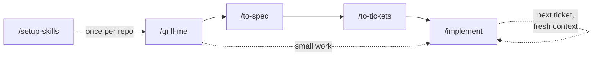

# skills

A small set of agent skills for taking a rough idea to reviewed, committed
code: sharpen it, spec it, slice it into tickets, build them test-first, review
the result.

Derived from [mattpocock/skills](https://github.com/mattpocock/skills) (MIT).

## Install

```bash
npx skills add loijilai/skills
```

**Select the "Loijilai Skills" group.** Its seven skills call each other, and a
missing one fails quietly.
Pick other up only if you want them.

Re-run the same command to update.

## Quick start

These are the commands you type.



| Command                                         | When                                                        | What it writes                                                                                                                                                                                                           |
| ----------------------------------------------- | ----------------------------------------------------------- | ------------------------------------------------------------------------------------------------------------------------------------------------------------------------------------------------------------------------ |
| [`/setup-skills`](skills/setup-skills/SKILL.md) | once per repo, before anything else                         | `docs/agents/issue-tracker.md` for the tracker you pick — local `issues/` or GitHub Issues — a `## Language` block in `AGENTS.md`, a `CLAUDE.md` that imports it, and `CODING_CONVENTION.md`; commits only if you say so |
| [`/grill-me`](skills/grill-me/SKILL.md)         | stress-test a plan or design                                | -                                                                                                                                                                                                                        |
| [`/to-spec`](skills/to-spec/SKILL.md)           | after /grill-me                                             | a spec, where your tracker keeps them                                                                                                                                                                                    |
| [`/to-tickets`](skills/to-tickets/SKILL.md)     | after /to-spec                                              | one ticket per vertical slice, each naming what blocks it                                                                                                                                                                |
| [`/implement`](skills/implement/SKILL.md)       | after /to-tickets, or on a spec or the settled conversation | source, tests, a commit — never the ticket, which stays yours to close                                                                                                                                                   |

## Brain dump

For turning what you dictate after reading or thinking into material for
scripts and articles. Select the "Brain Dump" group.

| Command                                     | When                                                                                                                      |
| ------------------------------------------- | ------------------------------------------------------------------------------------------------------------------------- |
| [`/brain-dump`](skills/brain-dump/SKILL.md) | a dictated summary transcript to clean up, split into sections, and fact-check before you revise it into a script or post |
| [`/to-script`](skills/to-script/SKILL.md)   | a draft video script to review for what it changes in the audience, then cut and reorder into `script.md`                 |

## Learning

For understanding something by working it out yourself. Select the "Learning"
group.

| Command                                     | When                                                                                                                         |
| ------------------------------------------- | ---------------------------------------------------------------------------------------------------------------------------- |
| [`/trace-code`](skills/trace-code/SKILL.md) | learning how to trace a change and test it by hand until you understand how the code behaves                                 |
| [`/coach-me`](skills/coach-me/SKILL.md)     | retrieval practice on a concept — guided one step at a time, no answers handed over, until you can recall it whole           |
| [`/teach-me`](skills/teach-me/SKILL.md)     | the minimum core of a concept, taught one step at a time — just enough to answer it in an interview                          |
| [`/to-kata`](skills/to-kata/SKILL.md)       | learning from a codebase by rebuilding part of it — a self-contained practice PRD to implement, then compare to the original |

## Productivity

Standalone commands. Use any time, independent of the flow above and of each
other. Select the "Productivity" group.

| Command                                     | When                                                                                                             |
| ------------------------------------------- | ---------------------------------------------------------------------------------------------------------------- |
| [`/wait-what`](skills/wait-what/SKILL.md)   | lost the thread of what the agent is doing — a short, plain-language re-pitch of the context and where it got to |
| [`/to-article`](skills/to-article/SKILL.md) | a discussion session or a rough draft ready to become a readable article                                         |

## Design

See [DESIGN.md](DESIGN.md) for the dependency diagram, the skills called
underneath, the principles behind them, and the caveats worth knowing.

## License

MIT. See [LICENSE](LICENSE) — it carries the original copyright from
[mattpocock/skills](https://github.com/mattpocock/skills), from which much of
this text is taken verbatim.
